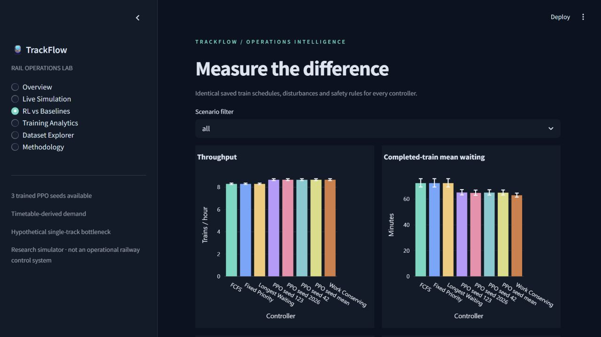
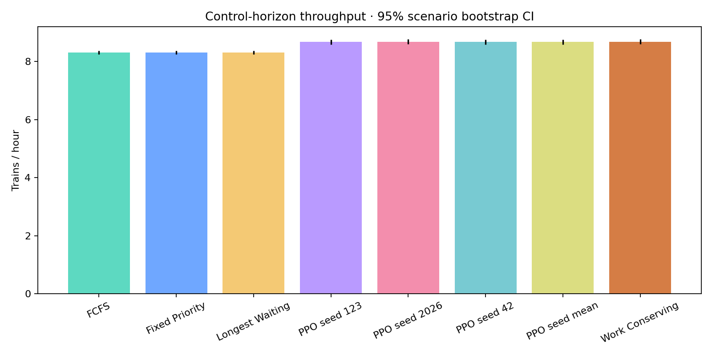

# TrackFlow — Train Traffic Throughput Control

A complete, executable research project that compares MaskablePPO with four rule-based
dispatchers on a bidirectional, capacity-one railway section. GTFS supplies the timetable;
the single-track bottleneck, clearance rules and random disruptions are explicit modeling
assumptions. The project measures outcomes rather than assuming reinforcement learning wins.



## What is included

- MBTA GTFS ingestion with checksum/provenance, calendars, after-midnight times,
  station normalization, frequency expansion, corridor ranking and synthetic fallback.
- Deterministic railway simulator with FIFO queues, entry/exit events, an independent
  safety gate, train conservation and exact integer-minute timing checks.
- A 14-feature Gymnasium environment and MaskablePPO training with checkpoint selection,
  TensorBoard/CSV logs and reproducible scenario generation.
- FCFS, fixed priority, longest waiting and work-conserving baselines.
- Fixed validation/test scenarios, paired bootstrap comparisons, train-level results,
  capacity bounds and recorded traces.
- Interactive and PNG charts plus a six-page Streamlit dashboard with functioning
  simulation playback, pause, resume, seek and reset.
- Automated data, simulation, Gymnasium, model, integration and dashboard tests.

## Quick start

Clone the repository, then install Python 3.12 dependencies in a virtual environment.
The repository includes trained models, processed data, fixed scenarios and evaluation
results, so you can explore the dashboard without downloading data or training a model.

Windows (PowerShell):

```powershell
git clone https://github.com/jithyadav8-dot/TrackFlow.git
cd TrackFlow
py -3.12 -m venv .venv
.\.venv\Scripts\python.exe -m pip install -r requirements.lock
.\.venv\Scripts\python.exe -m streamlit run app.py
```

Linux/macOS:

```bash
git clone https://github.com/jithyadav8-dot/TrackFlow.git
cd TrackFlow
python3.12 -m venv .venv
source .venv/bin/activate
python -m pip install -r requirements.txt
streamlit run app.py
```

Open [the dashboard](http://localhost:8501). No training occurs at dashboard startup.
The dashboard uses available checkpoints and explains missing artifacts instead of
inventing values. Python 3.11 is also supported by the project configuration.

The lockfile records the exact resolved Windows/Python 3.12 environment. Some transitive
versions may need resolution on Python 3.11 or other platforms; requirements.txt pins the
direct dependencies. Only Python 3.12.10 on CPU was executed in this delivery. If activation
is restricted, use the virtual environment's Python executable directly for every command.

## Reproduce the pipeline

Run from the project root with the virtual environment activated:

```bash
python scripts/prepare_data.py --strict
python scripts/generate_scenarios.py
python scripts/run_baselines.py
python scripts/smoke_test.py
python scripts/train.py --smoke
python scripts/train.py --seeds 42 123 2026
python scripts/evaluate.py
python scripts/generate_charts.py
python scripts/verify_reproducibility.py
streamlit run app.py
```

The supplied processed timetable and scenarios let you skip download and generation for
exact offline evaluation. A fresh download can change the feed; the configured service
date may no longer be covered. The raw GTFS archive, virtual environment and TensorBoard
event files are excluded from Git. If you have retained the original archive locally,
you can reprocess it with:

```bash
python scripts/prepare_data.py --archive data/raw/MBTA_GTFS.zip --date 2026-10-28 --strict
```

For a fully synthetic demonstration:

```bash
python scripts/prepare_data.py --synthetic
python scripts/generate_scenarios.py
python scripts/evaluate.py --baselines-only --output results/synthetic_demo
```

These preparation commands intentionally replace the processed input and scenario
manifest. Preserve a copy before switching datasets. Models record their training dataset
hash; evaluation rejects mismatches. Without `--strict`, download/validation failures
produce a clearly labelled synthetic fallback and save the reason and seed.

Completed training runs are protected from overwrite. To run another experiment in this
delivered checkout, use a new label:

```bash
python scripts/train.py --seed 42 --label replication_seed42
python scripts/train.py --seeds 42 123 2026 --label replication
python scripts/train.py --smoke --label second_smoke
```

Non-smoke default-reward runs update that seed's entry in `models/registry.json`.
Custom reward runs do not replace registered final models. All CLI scripts work without
an editable package install. Project paths derive from the source root.

## Data and physical model

The downloaded [MBTA feed](https://cdn.mbta.com/MBTA_GTFS.zip) supplies planned service for
2026-10-28. Reproducible scoring selected 52 movements between Back Bay (`place-bbsta`)
and South Station (`place-sstat`), starting at service minute 920 (15:20 local service time).
Arrivals retain their four-hour offsets; train-specific nominal traversal times are
derived from the feed. The raw archive hash, retrieval time, candidate ranking, processed
hash and quality report are saved under `data/metadata`.

**This does not assert that the real corridor is single track.** There is one hypothetical
section with capacity one, two directional FIFO queues, a two-minute clearance interval
and synthetic +/-2-minute traversal variation. GTFS priorities are uniformly one; the
synthetic generator demonstrates unequal priorities. Noise is assigned to each train once
before comparing controllers, so controller decisions cannot change its random realization.

At minute t, ready arrivals join and previously due exits have occurred. The controller
chooses HOLD, A→B or B→A. The safety gate validates dispatch. Remaining queues incur one
minute of waiting, occupied time accumulates, time advances and due exits are processed.
Exit at x permits the next entry at x+clearance. Every transition checks safety invariants.

## Learning and baseline methods

MaskablePPO uses MlpPolicy with 128/128 tanh layers for actor and critic. Observations
encode remaining time, occupancy, remaining traversal/clearance, queue lengths, head waits
and priorities, next timetable arrivals, last direction and completion/pending fractions.
It does not observe future random disturbances. See [the exact feature contract](docs/rl_methodology.md).

Default per-step reward is `2*completions - .05*weighted_waiting_minutes - .10*invalid
- .02*avoidable_hold`. A separate finite `-2*unfinished` penalty applies at truncation.
HOLD remains legal, and masks never replace independent physical checks.

FCFS selects the oldest ready head; priority compares head priority first; longest waiting
is equivalent to FCFS in this topology; work-conserving always dispatches when possible
and chooses A on ties. Directional FIFO is preserved by every controller.

Training uses dynamically generated scenarios. 30 fixed validation scenarios select
checkpoints by all accrued waiting per train plus 360 times unfinished fraction.
The 100 held-out test scenarios (20 per kind) are never used for model selection.
All policies continue through the same 120-minute drain period. TensorBoard can be opened with:

```bash
tensorboard --logdir logs
```

An exploratory, fixed-budget reward study uses only validation scenarios:

```bash
python scripts/reward_study.py
```

Its control, completion, waiting, holding and priority-weighting variants use seed 42 and
50000 requested steps each. The plan and results are saved separately and do not alter
the final-test model registry. This short study is not a claim of optimal hyperparameters.

## Evaluation and results

Throughput counts only exits by minute 240, divided by four hours. Utilization excludes
clearance. Waiting is entry minus readiness; schedule-relative delay is reported separately.
Mean/P95 waiting uses completed trains including the drain, so unfinished trains and
censored waits are reported alongside it. Early completion leaves unused horizon time idle.

The optimistic capacity check uses shortest assigned durations and inter-train clearance.
Bootstrap intervals resample whole scenarios (2000 samples, seed 31415). PPO seeds have
separate rows; seed-mean rows average the three models within each scenario before
bootstrapping. Zero percentage denominators are undefined. See [evaluation methods](docs/evaluation.md).

Actual completed-run results and the final test report are documented in [the handoff](docs/handoff.md).
Machine-readable results live in `results/episode_metrics.csv`, `train_metrics.csv`,
`comparison_summary.csv`, `paired_differences.csv`, `paired_summary.csv` and
`experiment_metadata.json`. Charts in `results/charts/` include both PNG and self-contained
local HTML with a shared Plotly JS asset. No simulated demonstration numbers are passed
off as evaluation results.

The delivered run trained seeds 42, 123 and 2026 for **503,808 transitions each** and
evaluated all seven controllers/models on the same 100 held-out scenarios (700 runs).
The following values average scenarios; PPO averages the three models within each
scenario. P95 is the average scenario-level P95. All safety-violation counts were zero.

|Controller|Trains/hour|Mean wait (min)|P95 wait (min)|Utilization|Unfinished trains|
|---|---:|---:|---:|---:|---:|
|FCFS|8.305|72.42|132.30|71.95%|6.89|
|Fixed Priority|8.305|72.42|132.30|71.95%|6.89|
|Longest Waiting|8.305|72.42|132.30|71.95%|6.89|
|Work Conserving|8.678|63.03|181.89|70.67%|6.66|
|PPO seed mean|8.675|65.04|163.72|70.66%|6.50|

PPO improved throughput and mean waiting relative to FCFS, but had worse tail waiting.
Work Conserving matched PPO throughput and had lower mean waiting; PPO had lower tail
waiting and backlog than that baseline. These results do not establish universal RL
superiority. The handoff includes paired confidence intervals and individual model seeds.



Final validation: **51 tests passed, 0 failed, 0 skipped**; all three dashboard tests
passed again with completed evaluation files. Ruff checks and formatting pass. A separate
replay reproduced all aggregate metrics for 35 controller/scenario runs within 1e-10.

## Verification

```bash
python -m pytest -q
python -m ruff check .
python -m ruff format --check .
python scripts/smoke_test.py
python scripts/verify_reproducibility.py
```

For restricted Windows sandboxes, a project-local pytest temporary directory avoids OS
temp ACL restrictions:

```powershell
python -m pytest -q --basetemp=.tmp/pytest-local -p no:cacheprovider
```

Tests cover GTFS times/calendars/frequencies, explicit network fallback, deterministic
selection, scenario isolation, illegal dispatches, event timing, conservation, FIFO,
zero trains, truncation, hand-calculated metrics, randomized actions, Gymnasium checking,
non-leaking observations, reward accounting, model reload, statistical edge cases,
data-to-chart integration, all dashboard pages and playback controls.

## Project map

```text
app.py                     six-page Streamlit application
configs/                   data, simulator, scenarios, PPO, evaluation YAML
src/data/                  ingestion, validation, corridor selection, scenarios
src/simulator/             train state, safety, events, transitions, metrics, Gymnasium
src/controllers/           four deterministic baselines
src/rl/                    training, callbacks, masked inference and validation
src/evaluation/            identical-scenario experiments, statistics, reporting
src/visualization/         charts, railway view and dashboard helpers
scripts/                   executable pipeline, study and reproducibility commands
tests/                     unit, integration and Streamlit AppTest coverage
data/processed/            CSV + Parquet timetable
data/scenarios/            frozen validation/test JSON and checksum manifest
data/metadata/             source and preprocessing evidence
models/                    smoke, full-seed and study checkpoints with metadata
logs/                      TensorBoard and PPO loss CSV
results/                   actual evaluation and bootstrap outputs
docs/                      architecture, data, simulator, RL, evaluation, limits, handoff
```

## Limits and extensions

Results generalize only to synthetic perturbations of one timetable window. GTFS is not
infrastructure data; priorities and disruptions are assumptions; safety is simplified;
RL superiority is not guaranteed. Completed-train averages can hide backlog and the
single-section topology offers limited scheduling choices. This is an academic prototype,
not an operational train-control product. See [limitations](docs/limitations.md).

Extensions include multiple independently protected sections, finite-capacity passing
loops, coordinated/multi-agent decisions, real-time timetable updates, richer signaling
and braking models, and network-level passenger-delay objectives. Preserve the validated
single-section environment as a regression reference when adding these capabilities.
