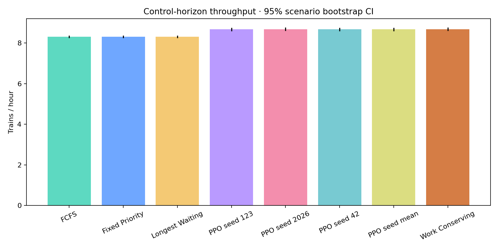

# TrackFlow final handoff

Completed delivery dated 2026-10-29 (Asia/Calcutta). Project: `C:\Users\Jagajith Yadav\OneDrive\Documents\ChatGPT\Trackflow`.

## A. Implementation summary

The GTFS pipeline creates a verified timetable and frozen scenarios. Four baselines
and MaskablePPO control the same independently protected railway simulator. Gymnasium
adds normalized observations, masks and per-step rewards. Training selects checkpoints
on 30 validation scenarios. Evaluation uses 100 held-out scenarios, exports individual
train/episode records and paired bootstrap statistics, and feeds eight measured charts
and a six-page Streamlit dashboard. Playback Run, Pause, Resume, Reset and seeking work.

Real input: 52 movements on 2026-10-28, Back Bay ↔
South Station, four-hour window beginning 15:20 local service time. The infrastructure,
priority assignments and disturbances are explicitly synthetic modeling assumptions.

## B. Project files

- [README and command reference](../README.md)
- [Dashboard](../app.py)
- [GTFS preprocessing](../src/data/prepare_schedule.py)
- [Simulator](../src/simulator/railway_section.py), [independent safety](../src/simulator/safety.py), [Gymnasium](../src/simulator/environment.py)
- [Training](../src/rl/train_ppo.py), [evaluation](../src/evaluation/experiments.py)
- [Processed timetable](../data/processed/train_schedule.csv), [dataset provenance](../data/metadata/dataset.json)
- [Episode results](../results/episode_metrics.csv), [train results](../results/train_metrics.csv)
- [Experiment metadata](../results/experiment_metadata.json), [acceptance report](../results/acceptance_report.json)

The README contains the actual directory map; tests are grouped by responsibility
rather than split into one file per individual simulator class.

## C. Commands

Windows installation in a fresh checkout:

```powershell
py -3.12 -m venv .venv
.\.venv\Scripts\python.exe -m pip install -r requirements.lock
.\.venv\Scripts\Activate.ps1
```

The delivered virtual environment already works. With it activated:

```bash
python scripts/prepare_data.py --archive data/raw/MBTA_GTFS.zip --date 2026-10-28 --strict
python scripts/generate_scenarios.py
python scripts/run_baselines.py
python scripts/smoke_test.py
python scripts/train.py --smoke --label fresh_smoke
python scripts/train.py --seeds 42 123 2026 --label replication
python scripts/evaluate.py
python scripts/generate_charts.py
python scripts/verify_reproducibility.py
python -m pytest -q
streamlit run app.py
```

Use `prepare_data.py --synthetic` for the labelled fallback. Preparation replaces
processed inputs/scenarios; preserve the supplied data for exact evaluation. A new
training label protects existing runs. Offline evaluation can start directly with
`evaluate.py` using the supplied data and models. Linux/macOS setup is in README.

## D. Trained models

Algorithm: MaskablePPO, actor/critic MLP hidden layers [128,128], tanh, CPU.
Main training completed 1,511,424 transitions
across three independent seeds. Smoke completed 20,480 transitions. Five separate
validation-only reward studies completed 53,248 transitions each. Every selected checkpoint
was saved and reloaded; masked inference was checked.

| Seed | Actual steps | Selected step | Validation cost | Validation mean wait | Checkpoint |
|---|---|---|---|---|---|
| 42 | 503808 | 300000 | 102.251 | 62.967 | models/seed_42/best.zip |
| 123 | 503808 | 503808 | 101.975 | 63.098 | models/seed_123/best.zip |
| 2026 | 503808 | 503808 | 102.232 | 62.939 | models/seed_2026/best.zip |

Validation cost is accrued wait per train plus 360 times unfinished fraction; lower
is better. Checkpoint selection uses this objective, not the held-out test results.

## E. Experimental results

700 controller/scenario runs on 100 saved test scenarios (20 each
normal, peak, disruption, imbalance and saturation). Values below are scenario means.
Throughput is trains/hour; waiting is minutes; utilization is a fraction. P95 is the
mean of scenario-level P95 waits, not the percentile of a pooled train population.
PPO seed mean averages the three trained models within each scenario.

| controller | throughput | mean_delay | p95_delay | utilization | incomplete_trains | safety_violations |
|---|---|---|---|---|---|---|
| FCFS | 8.305 | 72.422 | 132.299 | 0.719 | 6.890 | 0.000 |
| Fixed Priority | 8.305 | 72.422 | 132.299 | 0.719 | 6.890 | 0.000 |
| Longest Waiting | 8.305 | 72.422 | 132.299 | 0.719 | 6.890 | 0.000 |
| PPO seed 123 | 8.675 | 65.173 | 162.899 | 0.707 | 6.480 | 0.000 |
| PPO seed 2026 | 8.678 | 64.848 | 165.093 | 0.707 | 6.520 | 0.000 |
| PPO seed 42 | 8.672 | 65.093 | 163.169 | 0.707 | 6.490 | 0.000 |
| PPO seed mean | 8.675 | 65.038 | 163.721 | 0.707 | 6.497 | 0.000 |
| Work Conserving | 8.678 | 63.027 | 181.893 | 0.707 | 6.660 | 0.000 |

Relative to FCFS, PPO seed mean increased average throughput by
4.46% and reduced completed-train mean wait by
10.20%, but its mean scenario P95 wait was
23.75% higher. Thus RL did not improve every metric.
Compared with Work Conserving, PPO throughput differed by
-0.03% and mean waiting differed by
2.011 minutes (positive means PPO waited longer).
Inspect backlog and censored waits alongside completed-train means.

The following paired intervals resample scenarios (2000 bootstrap samples, seed 31415).
Differences are RL minus baseline, so negative favors RL for waiting/backlog:

| baseline | metric | mean_difference | ci_low | ci_high |
|---|---|---|---|---|
| FCFS | throughput | 0.370 | 0.290 | 0.453 |
| FCFS | mean_delay | -7.384 | -9.057 | -5.923 |
| FCFS | p95_delay | 31.421 | 27.873 | 35.209 |
| FCFS | incomplete_trains | -0.393 | -0.590 | -0.220 |
| FCFS | selection_cost | -6.665 | -8.194 | -5.264 |
| FCFS | utilization | -0.013 | -0.016 | -0.010 |
| Work Conserving | throughput | -0.002 | -0.016 | 0.010 |
| Work Conserving | mean_delay | 2.011 | 1.365 | 2.738 |
| Work Conserving | p95_delay | -18.173 | -21.206 | -15.399 |
| Work Conserving | incomplete_trains | -0.163 | -0.257 | -0.073 |
| Work Conserving | selection_cost | -1.286 | -1.905 | -0.660 |
| Work Conserving | utilization | -0.000 | -0.001 | 0.000 |

All 700 runs passed physical safety and finite-horizon capacity
checks. No result was edited to make RL look favorable. FCFS, priority and longest
waiting coincide here because GTFS priorities are uniform and longest waiting is
equivalent to earliest readiness. Unequal-priority tests validate the priority policy.

## F. Charts

Eight chart types, each exported as PNG and interactive HTML under `results/charts`:
throughput, delay, utilization, queues, timeline, scenarios, learning_reward, validation_delay. HTML shares a local Plotly JS bundle for offline use.



[Dashboard playback screenshot](dashboard-playback.png). All plotted metrics come
from executed evaluations and training logs. The separate `validation_preview`
directory is a clearly separated two-seed validation export used for chart QA.

## G. Test report

51 tests executed: **51 passed, 0 failed,
0 errors, 0 skipped**. See [JUnit XML](../results/test_report.xml)
and [captured output](../results/test_output.txt). Ruff checks and formatting pass;
pip reports no broken dependencies. Matplotlib's older pyparsing calls produce 14
dependency deprecation warnings; they did not fail tests or chart rendering.

Reproducibility re-executed 35 controller/scenario runs
across all five scenario kinds and matched every aggregate metric within absolute
tolerance 1e-10. Browser inspection verified real
playback and pause; AppTest exercises every page and Run/Pause/Resume/Reset.
All three dashboard tests also passed again with the completed evaluation files;
see `results/dashboard_test_report.xml`.

## H. Limitations and acceptance

All mandatory functional acceptance criteria are met. Python 3.12.10 was used because
3.11 was unavailable; 3.11 support was not executed. No Git commit existed during
the runs, so metadata records null commits and evaluation records source checksums.
The result is a research prototype, not operational railway-control certification.

One timetable date and synthetic perturbations limit external validity. The single
section is simple; directional preference explains much of the benefit (nominal A→B
duration averages 4.43 minutes versus 5.55 for B→A). This is a plausible explanation
from the inputs, not a causal ablation. P95 fairness and completed-train censoring
remain material. Three trained seeds do not fully characterize training uncertainty.
See [all limitations](limitations.md) and [the reward study](rl_methodology.md).

## I. Future improvements

Add multiple blocks with independent occupancy checks; finite-capacity passing loops
and route reservation; centralized or multi-agent coordination; real-time schedule
updates with explicit observed/forecast timestamps; realistic signaling and braking;
and network-level passenger-delay/connection objectives. Keep this single-section
simulator as a regression reference. The advanced topology remains an optional stretch
goal and was not implemented.
